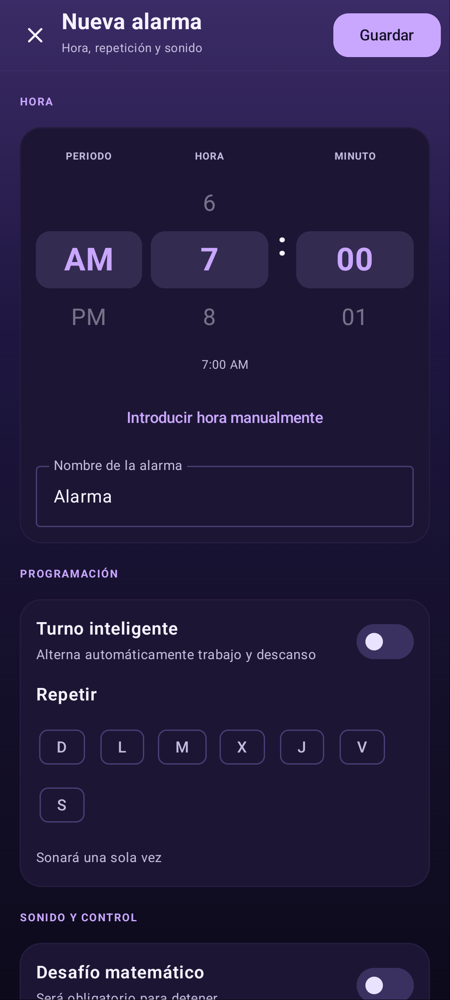

# Capturas de Despierta

Generadas automáticamente en un emulador Android 14 (Pixel 6) con datos ficticios y hora fija.

Commit de origen: `369bc76da9261f6c68860d945f7c27bfd31cbe7a`

## 01-alarmas

## 02-alarmas-lista

## 03-editor-alarma

## 04-editor-opciones

## 05-editor-nueva

## 06-sueno

## 07-sueno-editar

## 08-sueno-opciones

## 09-turnos

