# Capturas de Despierta

Generadas automáticamente en un emulador Android 14 (Pixel 6) con datos ficticios y hora fija.

Commit de origen: `5400c31fb07d3f3a9a9617554609142315f70289`

## 01-alarmas

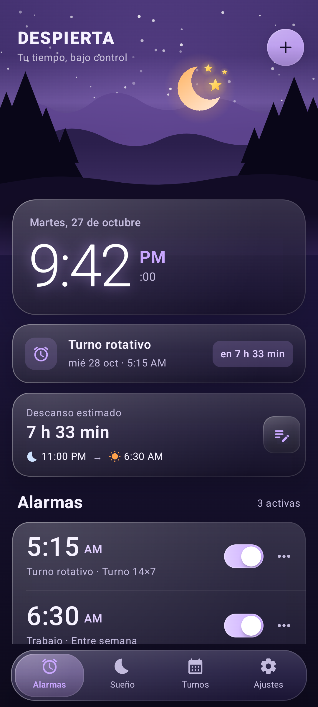

## 02-alarmas-lista

## 03-editor-alarma

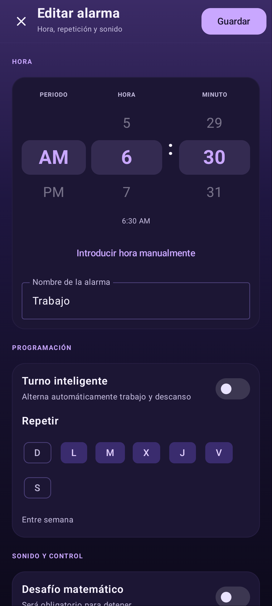

## 04-editor-opciones

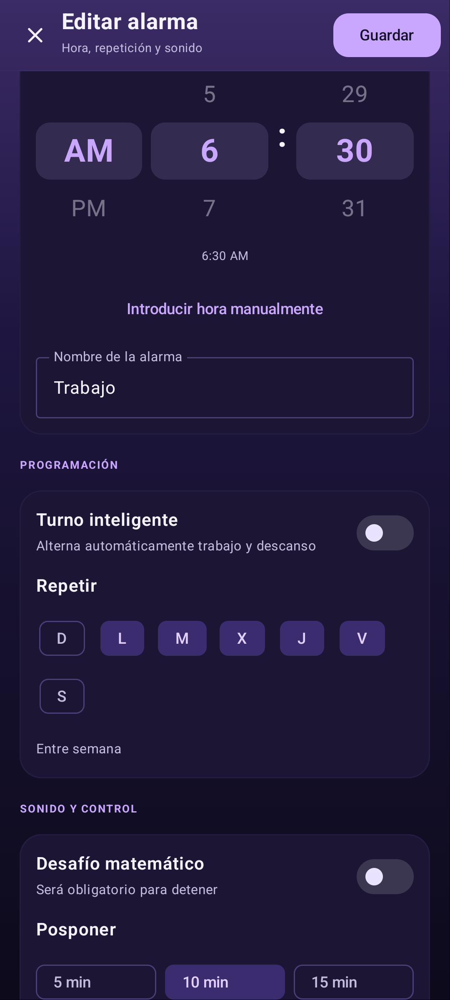

## 06-sueno

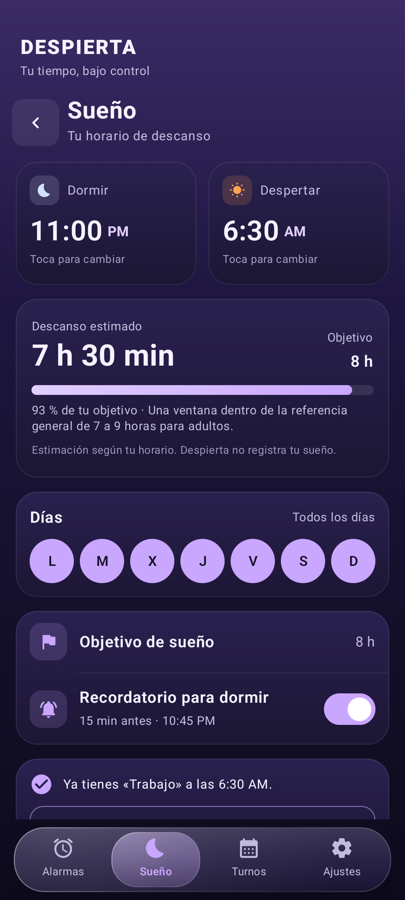

## 07-sueno-editar

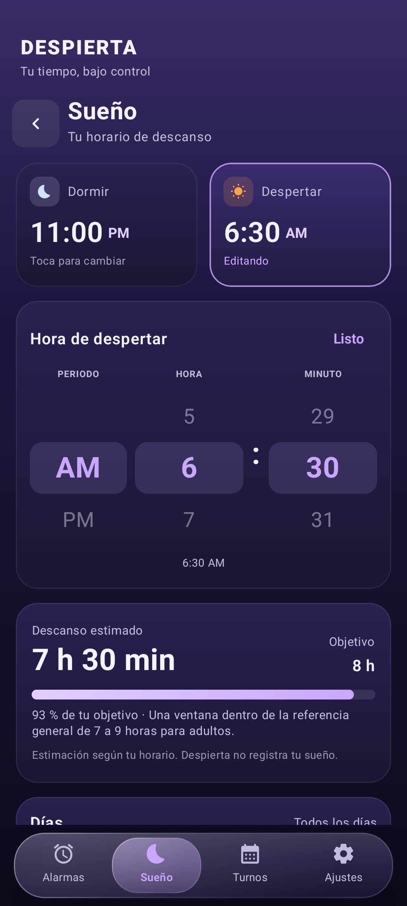

## 08-sueno-opciones

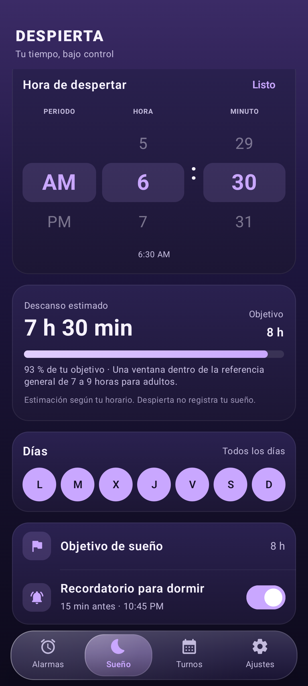

## 09-turnos

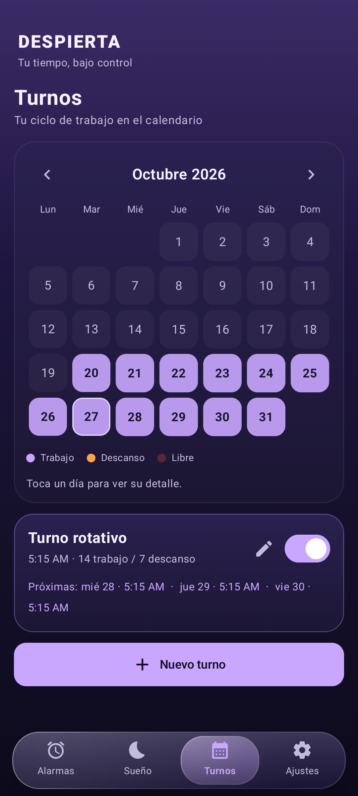

## 10-ajustes

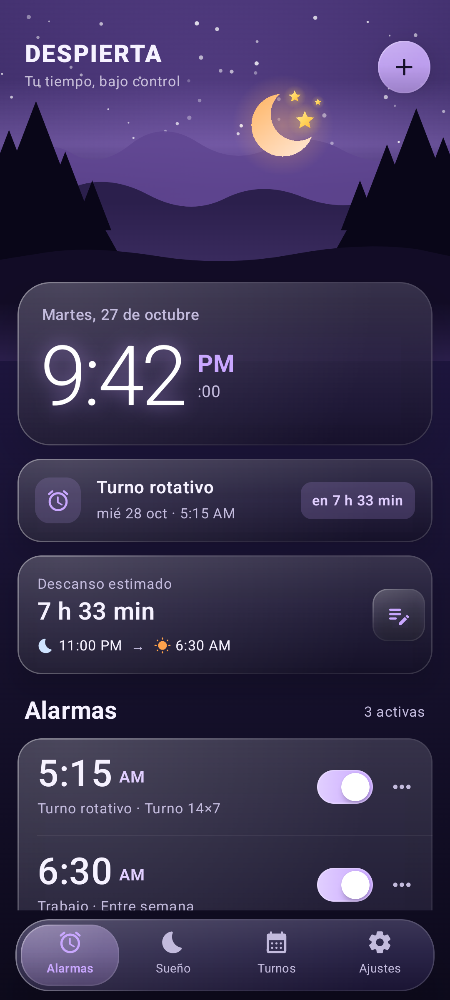

## 11-ajustes-apariencia

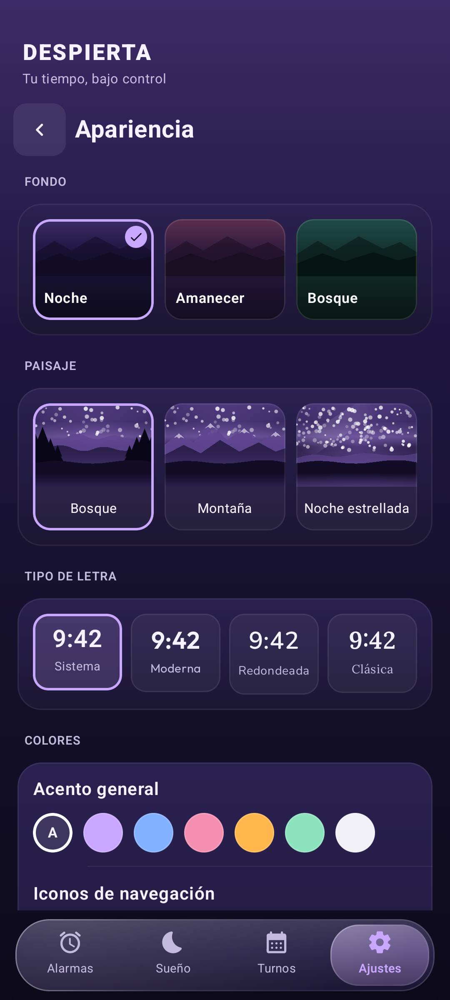

## 13-tema-amanecer

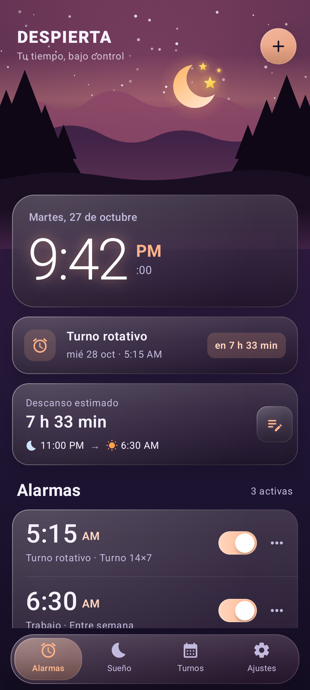

## 14-tema-bosque

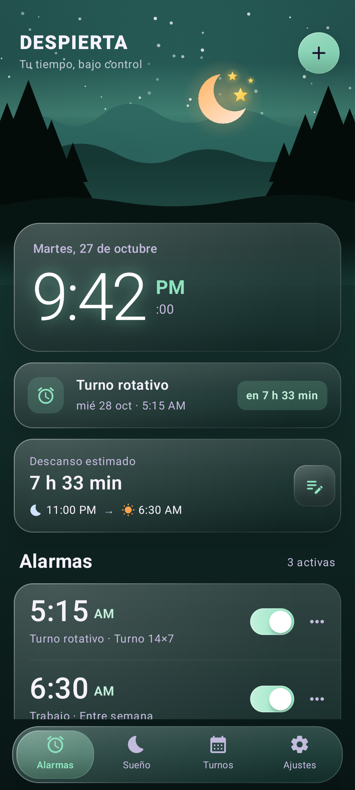

## 16-paisaje-montana

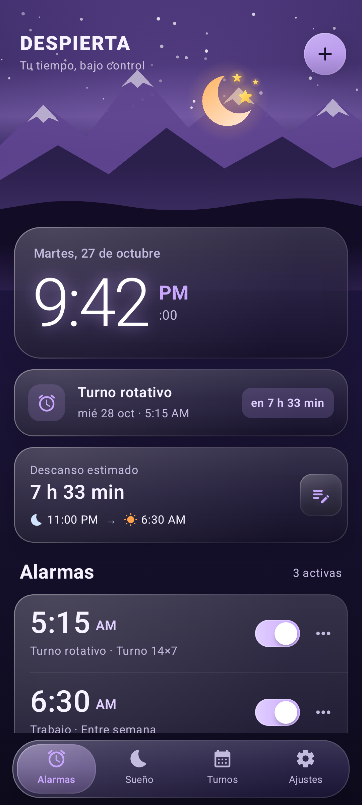

## 17-paisaje-estrellas

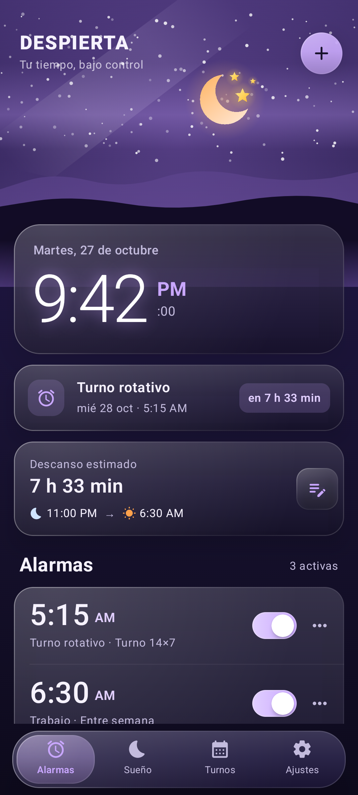

## 19-ajustes-paisaje-letra

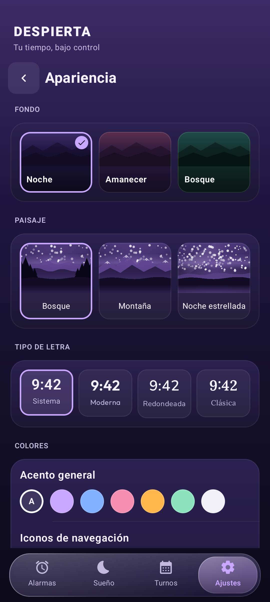

